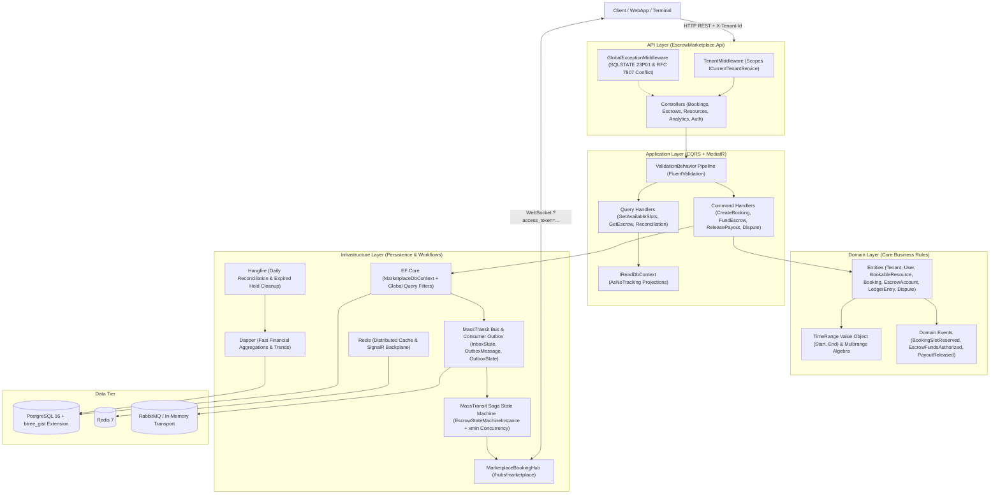
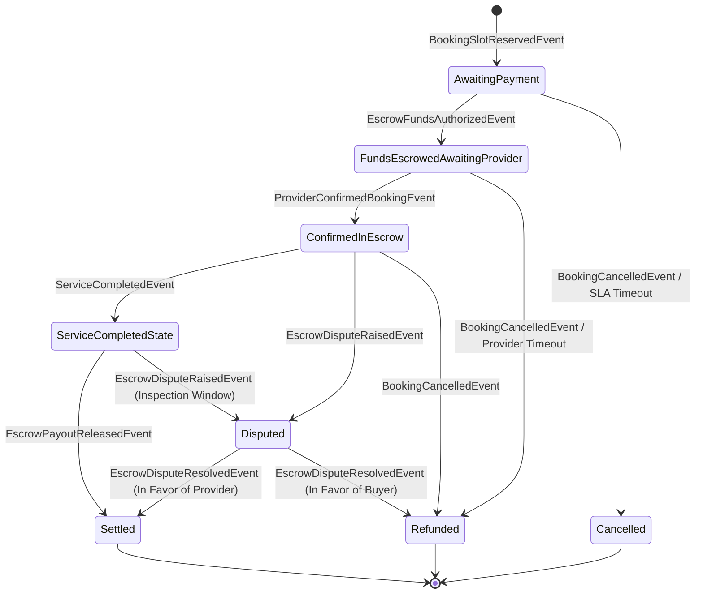

# 🛡️ Real-Time Escrow & Booking Marketplace with Event-Driven Workflows

[](https://dotnet.microsoft.com/)
[]()
[](https://masstransit.io/)
[](https://www.postgresql.org/)
[](https://learn.microsoft.com/aspnet/core/signalr/)
[](https://www.hangfire.io/)
[](https://redis.io/)

A production-grade, distributed ASP.NET Core 9 enterprise platform built for two-sided rental and service marketplaces (creative studios, equipment rentals, spaces, professional appointments). Engineered to eliminate race conditions, double-bookings, and split-brain financial discrepancies using native **PostgreSQL GiST exclusion constraints**, **MassTransit Transactional Outbox**, **Escrow Saga State Machines**, and **ASP.NET Core SignalR WebSockets**.

---

## 🏛️ System Architecture



---

## 🔄 Escrow Saga State Machine Workflow

Every reservation initiates an asynchronous financial escrow workflow governed by a persistent MassTransit State Machine. Funds are held safely in a segregated ledger until service verification or dispute arbitration.



---

## 💎 Key Architectural Highlights & Senior Design Decisions

### 1. Zero-Trust Double-Booking Prevention via PostgreSQL GiST Exclusion Constraints
- **The Problem**: Optimistic concurrency tokens (`uint RowVersion` / `xmin`) only guard updates to *existing* rows. Concurrent `INSERT` statements evaluating availability in read-committed isolation both read an empty conflict window and both insert overlapping rows.
- **The Solution**: Temporal availability is modeled as half-open intervals `[start, end)` (`tstzrange`). The schema deploys a native PostgreSQL **Exclusion Constraint** combining scalar equality with interval overlap using `btree_gist`:
  ```sql
  CREATE EXTENSION IF NOT EXISTS btree_gist;

  ALTER TABLE "Bookings"
  ADD CONSTRAINT excl_bookings_no_overlap
  EXCLUDE USING gist (
      "TenantId" WITH =,
      "ResourceId" WITH =,
      tstzrange(period_start, period_end, '[)') WITH &&
  )
  WHERE ("Status" NOT IN (5, 6, 7)); -- Excludes Cancelled, Expired, Refunded
  ```
- **Error Handling**: When concurrent requests race to reserve the same time slot, PostgreSQL aborts the loser with **SQLSTATE `23P01`** (`ExclusionViolation`). `GlobalExceptionMiddleware` catches this deterministically and maps it to an RFC 7807 `409 Conflict` problem details response.

### 2. Transactional Outbox Pattern (Eliminating the Dual-Write Trap)
- **The Problem**: Publishing message broker events synchronously inside MediatR command handlers creates an unrecoverable split-brain window. If database commit succeeds but message publishing crashes, downstream escrow capture never executes. If broker message is emitted first and database commit fails, downstream services process phantom funds.
- **The Solution**: The solution implements MassTransit's Entity Framework Core **Bus Outbox** and **Consumer Outbox** (`OutboxMessage`, `OutboxState`, `InboxState`). Domain events are written to the outbox table within the exact same ACID transaction as the `Booking` insertion. The outbox background worker guarantees at-least-once broker delivery, while `InboxState` guarantees exactly-once consumer execution.

### 3. Saga State Machine with PostgreSQL `xmin` Concurrency
- Long-running escrow agreements (authorized, funded, provider acceptance countdown, service completion, inspection hold, payout release, disputes) are coordinated by `EscrowStateMachine`.
- MassTransit's Saga repository operates in `ConcurrencyMode.Optimistic` leveraging PostgreSQL's native hidden system column `xmin` (`uint RowVersion`), eliminating database deadlocks during burst webhook and user update races.

### 4. Real-Time SignalR WebSockets & Transport-Layer JWT Handshake
- **Handshake Authentication**: Browsers cannot send custom HTTP headers during WebSocket negotiation. The client transmits the token via query string `?access_token=<jwt>`. The server configures `ConfigureJwtBearerOptions` (`IPostConfigureOptions<JwtBearerOptions>`) to intercept query string tokens *strictly* for `/hubs/marketplace` endpoints.
- **Connection Security**: Configured with `CloseOnAuthenticationExpiration = true` so WebSocket connections do not outlive short-lived access tokens.
- **Decoupled Event Bridge**: MassTransit consumer `EscrowStatusChangedSignalRConsumer` injects `IHubContext<MarketplaceBookingHub, IBookingClient>` to broadcast state updates across tenant groups (`tenant:{id}`), user groups (`user:{id}`), and booking streams (`booking:{id}`).

### 5. Multi-Tenancy & Dual ORM Pattern
- **Query Isolation**: Dynamic EF Core global query filters (`e => CurrentTenantId == null || e.TenantId == CurrentTenantId`) bound to all `ITenantEntity` instances.
- **Auto-Stamping**: `SaveChangesAsync` injects `TenantId` and audit timestamps (`CreatedAt`, `UpdatedAt`) automatically.
- **Dual ORM**: EF Core handles complex relational writes, constraints, and outbox tables. **Dapper** (`DapperAnalyticsRepository`) executes high-speed analytical queries for financial ledger reconciliation and booking volume trends.

---

## 📂 Project Structure

```
Real-Time Escrow & Booking Marketplace with Event-Driven Workflows/
├── src/
│   ├── EscrowMarketplace.Domain/                # Pure business logic, zero external deps
│   │   ├── Common/                              # BaseEntity, ITenantEntity, IAuditableEntity
│   │   ├── Entities/                            # Booking, EscrowAccount, BookableResource, User, Tenant, Dispute
│   │   ├── Enums/                               # BookingStatus, EscrowStatus, LedgerEntryType, DisputeStatus
│   │   ├── Events/                              # Domain & integration events (BookingSlotReserved, etc.)
│   │   ├── Exceptions/                          # DoubleBookingExclusionException, DomainException
│   │   └── ValueObjects/                        # TimeRange [Start, End), Money
│   │
│   ├── EscrowMarketplace.Application/           # CQRS Commands, Queries, Handlers & Pipeline
│   │   ├── Common/                              # Interfaces, Pipeline Behaviors (Validation, Logging), DTOs
│   │   ├── Features/Bookings/                   # CreateBooking, Confirm, Complete, Cancel, GetAvailableSlots
│   │   ├── Features/Escrows/                    # Authorize, Fund, ReleasePayout, Refund, RaiseDispute, Resolve
│   │   └── Features/Resources/                  # CreateResource, GetResources
│   │
│   ├── EscrowMarketplace.Infrastructure/        # Database, Messaging, Saga, Cache, Jobs
│   │   ├── Persistence/                         # MarketplaceDbContext (GiST exclusion, xmin), ReadDbContext
│   │   ├── Saga/                                # EscrowBookingState, EscrowStateMachine
│   │   ├── Consumers/                           # EscrowStatusChangedSignalRConsumer, BookingEventAuditConsumer
│   │   ├── Repositories/                        # DapperAnalyticsRepository (Reconciliation & Daily Trends)
│   │   ├── Services/                            # CurrentTenantService, RedisCacheService, MockPaymentGateway
│   │   ├── Jobs/                                # Hangfire LedgerReconciliationJob, EscrowTimeoutCleanupJob
│   │   └── Hubs/                                # MarketplaceBookingHub (SignalR WebSocket streaming)
│   │
│   └── EscrowMarketplace.Api/                   # Presentation Layer
│       ├── Controllers/                         # BookingsController, EscrowsController, Resources, Analytics, Auth
│       ├── Middleware/                          # GlobalExceptionMiddleware (23P01 mapping), TenantMiddleware
│       └── Authentication/                      # ConfigureJwtBearerOptions (WebSocket query string token handler)
│
├── tests/
│   ├── EscrowMarketplace.UnitTests/             # Domain algebra, TimeRange overlap, Escrow fees, Validators
│   └── EscrowMarketplace.IntegrationTests/      # WebApplicationFactory API tests, 409 Conflict, Escrow lifecycle
│
├── docker-compose.yml                           # PostgreSQL 16 (btree_gist), Redis 7, RabbitMQ 3-management
├── Dockerfile                                   # Multi-stage production container build
├── EscrowMarketplace.sln                        # Visual Studio / Rider solution
└── README.md                                    # Comprehensive documentation
```

---

## 🚀 Getting Started

### Prerequisites
- [.NET 9 SDK](https://dotnet.microsoft.com/download/dotnet/9.0)
- [Docker Desktop](https://www.docker.com/) (for PostgreSQL, Redis, and RabbitMQ)

### 1. Start Infrastructure via Docker Compose
Run the backing services (PostgreSQL 16, Redis 7, RabbitMQ Management):
```bash
docker compose up -d postgres redis rabbitmq
```

### 2. Run the API Locally
```bash
cd "D:\006-C#dev\Real-Time Escrow & Booking Marketplace with Event-Driven Workflows"
dotnet run --project src/EscrowMarketplace.Api
```

The application starts on `http://localhost:5000` (or configured HTTPS port).
- **Interactive API Docs (Scalar)**: `http://localhost:5000/scalar/v1`
- **OpenAPI Schema**: `http://localhost:5000/openapi/v1.json`
- **Hangfire Dashboard**: `http://localhost:5000/hangfire`
- **SignalR Hub**: `ws://localhost:5000/hubs/marketplace`

---

## 🧪 Running the Automated Tests

The solution features a comprehensive automated test suite testing temporal algebraic invariants, fee schedules, exclusion conflicts, and complete escrow flows:

```bash
dotnet test
```

### Test Suite Summary:
```text
Passed!  - Failed: 0, Passed: 18, Skipped: 0, Total: 18 - EscrowMarketplace.UnitTests.dll
Passed!  - Failed: 0, Passed:  6, Skipped: 0, Total:  6 - EscrowMarketplace.IntegrationTests.dll
Total: 24 tests passed (100% success rate)
```

| Test Class | Focus Area |
| :--- | :--- |
| `TimeRangeTests` | Mathematical interval overlap (`[start, end)`), adjacency, containment, and intersection. |
| `BookingAggregateTests` | State machine invariants, valid state transitions, and invalid transition exceptions. |
| `EscrowAccountTests` | Commission breakdown, provider payout calculation, hold deposits, disbursements, and refunds. |
| `CreateBookingCommandValidatorTests` | FluentValidation rules for timestamps, minimum 15-minute slot durations, and required fields. |
| `BookingEndpointsTests` | HTTP integration tests verifying slot reservations, available slots, and `409 Conflict` on overlap. |
| `EscrowWorkflowTests` | End-to-end multi-step escrow lifecycle (Authorize -> Fund -> Release) and dispute arbitration. |

---

## 📋 Seeded Demo Data

Upon initial startup, the database initializer automatically provisions a ready-to-test tenant, counterparties, and bookable studio assets:

- **Tenant**: `Apex Creative Spaces & Studios` (Id: `11111111-1111-1111-1111-111111111111`, Identifier: `apex-studios`)
- **Users**:
  - `admin@marketplace.local` (Platform Administrator)
  - `sophia@vancestudios.com` (Studio Host / Provider, Id: `33333333-3333-3333-3333-333333333333`)
  - `marcus@soundwave.io` (Audio Producer / Buyer, Id: `44444444-4444-4444-4444-444444444444`)
- **Bookable Resources**:
  - `Master Acoustic Live Room A` ($75.00/hr, Id: `55555555-5555-5555-5555-555555555555`)
  - `Dolby Atmos Mixing & Mastering Suite` ($120.00/hr, Id: `66666666-6666-6666-6666-666666666666`)
  - `Vocal Isolation Booth & Neumann U87` ($45.00/hr, Id: `77777777-7777-7777-7777-777777777777`)

To generate an authenticated JWT token for testing, invoke:
```http
POST /api/auth/token
Content-Type: application/json

{
  "email": "marcus@soundwave.io"
}
```

---

## 📄 License
MIT License. Built for high-volume, event-driven marketplace architectures.
