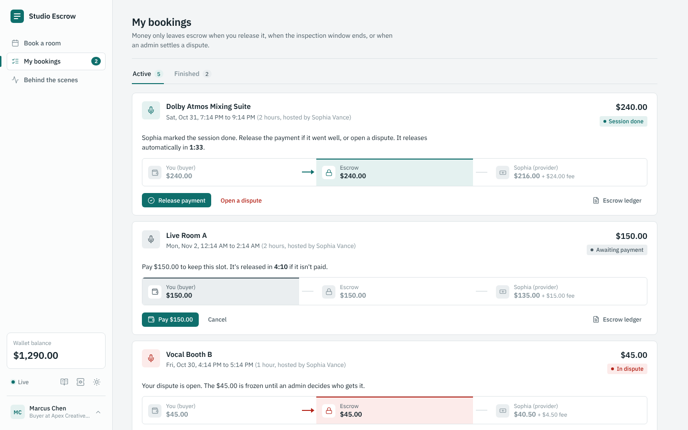
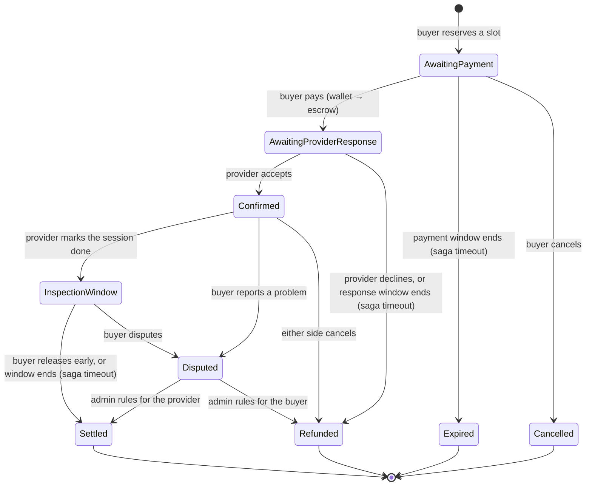
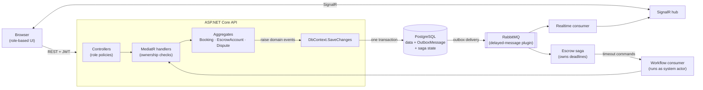

# Studio Escrow: booking marketplace with an event-driven escrow workflow

A two-sided marketplace for booking recording studios, built with ASP.NET Core 9. Buyers reserve a room and pay into escrow. Providers accept the booking and mark the session done. The money is released to the provider only when the buyer approves, when the inspection window ends without a dispute, or when an admin settles a dispute.

The interesting parts are the guarantees behind that flow:

- **No double bookings, even under concurrent requests.** A PostgreSQL GiST exclusion constraint enforces it, not just an application check.
- **No lost or phantom events.** Domain events are written to a transactional outbox in the same database transaction as the state change.
- **Deadlines are handled by a saga, not by polling.** Payment windows, provider response windows and the inspection window are scheduled messages. When one fires, the saga issues a command that runs through the normal domain rules.
- **Money is conserved.** Every dollar a buyer pays into escrow ends up as payout + platform fee, or goes back to the buyer. There is exactly one code path for each.
- **Tenant isolation fails closed.** The tenant comes from the signed token only, and the query filter returns nothing when no tenant is set.



---

## How a booking moves



These are the escrow saga's states (`EscrowStateMachine`). The aggregates have their own, simpler statuses (`BookingStatus`, `EscrowStatus`) and enforce which transitions are legal.

## Architecture



The split of responsibilities is deliberate. **Aggregates own the rules.** Every user action is a synchronous command that validates and changes state immediately, so the API can answer "yes" or "no, because…" right away. **The saga owns time and coordination.** It listens to domain events, tracks where each booking is, and schedules a timeout message for every deadline. When a timeout fires, it doesn't change data itself: it issues a command (`ExpireUnpaidBooking`, `CancelUnconfirmedBooking`, `ReleaseEscrowAfterInspection`) that runs through the same handlers and domain rules as a user action.

## Design decisions and trade-offs

### 1. Double-booking prevention: a database constraint, not a check-then-insert

Checking for overlaps before inserting is not safe. Two requests can both read "free" before either commits. Serializable isolation would catch that, but it fails whole transactions under load and needs retry logic everywhere. Instead, bookings store `[start, end)` and PostgreSQL enforces:

```sql
ALTER TABLE "Bookings" ADD CONSTRAINT excl_bookings_no_overlap
EXCLUDE USING gist (
    "TenantId" WITH =,
    "ResourceId" WITH =,
    tstzrange(period_start, period_end, '[)') WITH &&
) WHERE ("Status" NOT IN (5, 6, 7));   -- Cancelled, Expired, Refunded free the slot
```

The application still pre-checks, but only to give a friendly error message. The constraint violation (SQLSTATE `23P01`) is mapped to `409 Conflict`. `BookingEndpointsTests.ConcurrentOverlappingRequests_ExactlyOneWins` fires 12 simultaneous requests at real PostgreSQL and asserts exactly one `201`. Half-open ranges mean back-to-back bookings (10:00–11:00 and 11:00–12:00) don't conflict.

*Trade-off:* EF Core can't model exclusion constraints, so it's applied idempotently at startup (`MarketplaceDbContextInitializer`), and the app refuses to start if that fails. In a team setting I'd move it into a hand-written migration.

### 2. Transactional outbox: no dual writes

Saving a booking and then publishing an event to RabbitMQ are two systems. A crash between them loses the event, and publishing first can announce something that never got saved. Here, aggregates raise events (`booking.MarkPaid(...)` adds `BookingPaidEvent`). `MarketplaceDbContext.SaveChangesAsync` publishes them through MassTransit's EF Core bus outbox, which writes them to the `OutboxMessage` table in the same transaction as the data. A background delivery service sends them to the broker after commit. Consumers use the EF inbox/outbox too, so redelivered messages are de-duplicated.

### 3. The saga owns deadlines

The earlier version polled with a Hangfire job every 10 minutes. It had a bug that re-processed the same rows forever, and it was imprecise. Now each deadline is a scheduled message. A few details make this robust:

- **Timeouts are idempotent.** `ReleaseAfterInspectionCommand` only releases if the booking is still `Completed`. If the buyer disputed a second earlier, it's a no-op, not an error.
- **Unscheduling is token-based.** RabbitMQ delayed messages can't be cancelled. When the buyer acts first, the saga clears the stored token, so when the stale message arrives it's ignored.
- **Order-independence.** Events from separate transactions can overtake each other. Money-final events (`EscrowPayoutReleasedEvent`, `EscrowRefundedEvent`, `BookingExpiredEvent`) are accepted from any state, so a fast "approve" can't leave the saga stuck.
- **Concurrency.** The saga row uses PostgreSQL `xmin` optimistic concurrency, and its endpoint processes one message at a time, with in-place retries that keep delivery order. *Trade-off:* that caps throughput. At scale you'd partition by `BookingId`.
- Hangfire is still used for what it's good at: a nightly ledger reconciliation per tenant.

### 4. Money is conserved by construction

Payments are simulated with a wallet balance per user. Paying debits the buyer's wallet, and the `EscrowAccount` records every movement in an append-only ledger. Money leaves escrow through exactly two functions in `EscrowSettlement`: `ReleaseToProvider` (payout + platform fee) and `RefundToBuyer` (full amount). Buyer approval, the inspection timeout, dispute resolution and cancellation all call one of them. The `User` row has an `xmin` concurrency token, so two simultaneous payments can't both spend the same balance. A real payment provider would plug in where `PayForBookingCommand` authorizes and captures.

### 5. Security and tenant isolation

- **Every endpoint requires a valid JWT by default** (fallback policy). Role policies add Buyer, Provider and Admin restrictions on top.
- **Handlers check ownership.** Only this booking's buyer can pay or approve, and only its provider can accept or complete. Identity always comes from the token, never from the request body. A user who isn't part of a booking gets `404`, not `403`, so ids can't be probed.
- **The tenant comes from the token's `tenant_id` claim only.** The previous version trusted an `X-Tenant-Id` header, which let anyone read another tenant's data. The EF global query filter fails closed: with no tenant set it matches nothing, and the few legitimate cross-tenant reads (login, background consumers) opt out explicitly with `IgnoreQueryFilters()`.
- **SignalR groups come from token claims.** Clients can't subscribe to arbitrary booking ids.
- **Demo login is passwordless and switchable.** It's controlled by `Demo:PasswordlessLogin`. A real deployment would use an identity provider, and nothing else in the API would change, because it only trusts validated tokens.

## Running it

**Requirements:** .NET 9 SDK and Docker Desktop.

### Everything in Docker

```bash
docker compose up --build
```

Open http://localhost:5000. Compose shortens the windows for demos: 5 minutes to pay, 10 to accept, 2 minutes of inspection before automatic payout.

### Infrastructure in Docker, API from your IDE

```bash
docker compose up -d postgres rabbitmq redis
dotnet run --project src/EscrowMarketplace.Api
```

Open http://localhost:5000. The Development profile uses the same short windows.

> **Upgrading from the earlier version?** The schema changed. Reset the database volume once: `docker compose down -v`.

### Database migrations

On first run, if no migrations exist, the schema is created with `EnsureCreated` and a warning is logged. To switch to migrations:

```bash
dotnet tool install --global dotnet-ef
dotnet ef migrations add InitialCreate --project src/EscrowMarketplace.Infrastructure --startup-project src/EscrowMarketplace.Api
```

After that, startup applies migrations automatically.

### Without Docker

Set `"UseInMemoryDatabase": true` and an empty `RabbitMQ:Host`. You get EF in-memory storage, the in-memory transport and in-memory saga storage, which is enough to click through the UI. You lose the exclusion constraint, the outbox (events are published after save) and the workflow-state endpoint.

## Demo walkthrough

1. Open two browser windows. Sign in as **Marcus (buyer)** in one and **Sophia (provider)** in the other.
2. Marcus books *Vocal Booth B* and pays. His wallet drops and the money trail moves to escrow.
3. Sophia sees the request appear live, accepts it, then marks the session done.
4. Marcus does nothing. After the 2-minute inspection window, the saga releases the payout and Sophia's wallet goes up. Watch it happen under **Behind the scenes**.
5. Repeat, but this time Marcus opens a dispute. Sign in as **Avery (admin)** to settle it either way.
6. Under **Behind the scenes**, the double-booking test sends 8 simultaneous requests for one slot. Exactly one gets through.
7. Sign in as **Lena** (Northwind, a different tenant). She can't see anything from Apex.

## Tests

```bash
dotnet test
```

Integration tests need Docker running (they start a throwaway PostgreSQL 16 container with Testcontainers).

| Suite | Covers |
|---|---|
| `UnitTests/Domain` | Booking and escrow state machines, ledger entries, money conservation in `EscrowSettlement`, wallet overdraft, regressions (dispute resolved for the provider, cancelling a disputed booking). |
| `UnitTests/Application` | Booking validation (duration bounds, past start times). |
| `IntegrationTests/Api/BookingEndpointsTests` | 409 on overlap, half-open ranges, **12 concurrent requests → exactly 1 succeeds**, cancelled slots become free, available slots. |
| `IntegrationTests/Api/EscrowWorkflowTests` | Full lifecycle with wallet deltas and ledger, **automatic payout after the inspection window** (outbox → saga → scheduled timeout → consumer), dispute blocks auto-release, both dispute outcomes, cancellations before and after payment. |
| `IntegrationTests/Api/SecurityTests` | 401 for anonymous calls, role 403s, other buyers get 404, cross-tenant isolation (including a spoofed `X-Tenant-Id` header), insufficient funds → 422 with nothing changed. |
| `IntegrationTests/Saga/EscrowStateMachineTests` | Saga transitions and real timeouts on MassTransit's test harness: payment expiry, early payment cancels the timeout, auto-release, dispute cancels auto-release, out-of-order events. |

## API overview

| Method | Route | Who | What |
|---|---|---|---|
| POST | `/api/auth/token` | anyone (demo) | Token for a seeded user by email |
| GET | `/api/me` | signed in | Profile and wallet balance |
| GET | `/api/resources` | signed in | Rooms in your tenant |
| POST | `/api/bookings` | buyer | Reserve a slot |
| GET | `/api/bookings` | signed in | Your bookings (admins: all in tenant) |
| POST | `/api/bookings/{id}/pay` | buyer of the booking | Wallet → escrow |
| POST | `/api/bookings/{id}/confirm` | provider of the booking | Accept |
| POST | `/api/bookings/{id}/complete` | provider of the booking | Start the inspection window |
| POST | `/api/bookings/{id}/approve` | buyer of the booking | Release payout early |
| POST | `/api/bookings/{id}/cancel` | buyer, provider, admin | Cancel, refunding if paid |
| POST | `/api/bookings/{id}/dispute` | buyer or provider | Freeze funds |
| GET | `/api/bookings/{id}/workflow` | participants, admin | Saga state and next deadline |
| GET | `/api/escrows/booking/{id}` | participants, admin | Escrow and ledger |
| POST | `/api/escrows/disputes/{id}/resolve` | admin | Refund buyer or pay provider |
| GET | `/api/analytics/reconciliation` | admin | Tenant money totals (Dapper) |

Interactive docs: `/scalar/v1`. Hangfire dashboard: `/hangfire` (local requests only). RabbitMQ: http://localhost:15672 (guest / guest).

## Project structure

```
src/
  EscrowMarketplace.Domain/          Aggregates, value objects, domain events, EscrowSettlement
  EscrowMarketplace.Application/     MediatR commands/queries, validation, access checks
  EscrowMarketplace.Infrastructure/  EF Core + outbox, saga, consumers, SignalR hub, Dapper, Hangfire
  EscrowMarketplace.Api/             Controllers, auth, middleware, wwwroot (UI)
infra/rabbitmq/                      RabbitMQ image with the delayed-message plugin
tests/                               Unit, integration (Testcontainers) and saga tests
```

The UI is plain HTML, CSS and vanilla JS with no build step, styled like a bank statement: flat white panels, fine borders, IBM Plex Sans and a sidebar. It uses three colours, each with one meaning: teal is money held in escrow, green is money released to the provider, and red is a dispute or an error. Refunds and cancellations stay neutral grey.

## What I'd do next

- A real payment provider (authorize/capture with idempotency keys) instead of the simulated wallet.
- A cancellation policy (partial refunds close to the session) instead of always refunding in full.
- Only allow "mark done" after the session's start time, plus per-room opening hours and time zones.
- Partition the saga endpoint by `BookingId` instead of processing one message at a time.
- OpenTelemetry tracing across HTTP → outbox → broker → saga.
- Move the exclusion constraint into a migration, and add outbox and inbox cleanup monitoring.

## License

MIT
